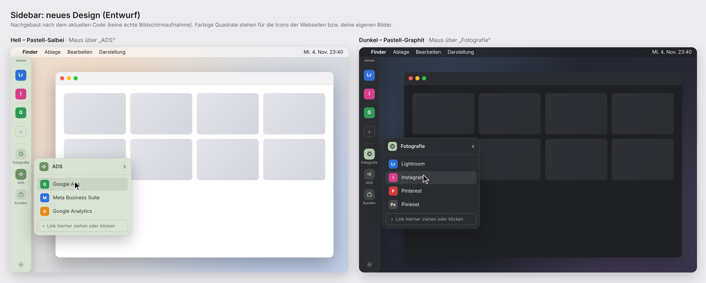

# Sidebar für macOS

Eine schlanke, native Sidebar für macOS (Apple Silicon, macOS 14 Sonoma oder neuer).
Sie dockt an einer beliebigen Bildschirmkante an, zeigt eingeklappt nur Icons und
klappt beim Darüberfahren mit der Maus auf. Links sind in Gruppen sortiert
(z. B. **Fotografie**, **ADS**) und lassen sich wie kleine „Browser-Apps“ öffnen.



## Funktionen

- **Schlanke Leiste:** oben bis zu **6 Favoriten** für den Schnellzugriff,
  darunter die **Ordner** (z. B. Fotografie, ADS).
- **Ordner-Fenster beim Hover:** Fährst du über einen Ordner, öffnet sich
  daneben ein Fenster mit allen Links, immer vom Rand weg (links → nach
  rechts, rechts → nach links, oben → nach unten, unten → nach oben).
- **Icons passen sich an:** Je mehr in der Leiste ist, desto kleiner werden
  die Icons. Erst wenn sie zu klein würden, lässt sich die Leiste scrollen.
- **Drag & Drop:**
  - Adresse aus dem Browser auf einen Ordner, ins Ordner-Fenster oder auf
    die Favoriten ziehen
  - Link aus einem Ordner auf die Favoritenleiste ziehen
  - Link in einen anderen Ordner ziehen
  - **Programme, Dateien und Ordner vom Mac** aus Finder, Dock oder vom
    Schreibtisch hineinziehen. Sie öffnen sich mit macOS und zeigen ihr
    Original-Icon.
  - Bilddatei auf ein Icon ziehen = eigenes Icon
  - **Reihenfolge per Ziehen:** Favoriten untereinander, Links im
    Ordner-Fenster und Ordner in der Leiste
  - **In den Einstellungen:** Links aus dem Browser an eine beliebige Stelle
    einer Liste ziehen, auf einen Ordner oder auf „Favoriten“ in der linken
    Spalte ziehen, Reihenfolge per Ziehen ändern
- **Ein „+“-Feld pro Liste:** am Ende jedes Ordner-Fensters und bei den
  Favoriten (solange Platz ist). Hineinziehen oder klicken.
- **Eigene Bilder als Icons:** Rechtsklick → „Eigenes Bild wählen …“ oder im
  Link-Editor. Das Bild wird quadratisch zugeschnitten.
- **Farben:** hell in Pastell-Salbeigrün, dunkel in Pastell-Graphit oder
  automatisch passend zum macOS-Modus.
- **Jeder Bildschirm, jede Seite:** am Griff an eine Kante oder auf einen
  anderen Monitor ziehen. Die Position wird gespeichert.
- **Vordergrund wählbar:** „Immer im Vordergrund“ oder hinter Fenstern.
- **Drei Öffnungsarten** (global einstellbar, pro Link überschreibbar):
  | Art | Verhalten |
  | --- | --- |
  | Standard-Browser | neuer Tab in Safari/Chrome/… |
  | Integriertes App-Fenster | eigenes Fenster in der Sidebar-App, mit Zurück/Vor/Neu laden, Downloads und Datei-Uploads. Logins werden gespeichert, getrennt vom Browser. |
  | Chrome-App-Fenster | Chrome/Edge/Brave/Vivaldi im `--app`-Modus: eigenes Fenster ohne Tabs und Adressleiste, **mit den Logins deines Browserprofils** |
- **Automatisch ausblenden:** Eingeklappt bleibt nur ein 4 pt schmaler Rand.
- **Updates per Klick**, **Menüleisten-Symbol**, **Start bei Anmeldung**.

## Installation

Voraussetzung: Xcode **oder** die Command Line Tools (`xcode-select --install`).

```bash
git clone https://github.com/ziege1988/Sidebar.git
cd Sidebar
./build.sh --install     # baut, kopiert nach /Programme und startet
```

Nur bauen, ohne zu installieren: `./build.sh` → `build/Sidebar.app`.

**Alternativ ohne Kompilieren:** Unter
[Releases](https://github.com/ziege1988/Sidebar/releases/latest) die Datei
`Sidebar.zip` laden, entpacken und `Sidebar.app` nach *Programme* ziehen. Da die
App nicht notarisiert ist, blockiert macOS den ersten Start: Warnung mit „Fertig“
schließen → *Systemeinstellungen → Datenschutz & Sicherheit* → ganz unten
„Dennoch öffnen“.

**Mit Xcode entwickeln:** `open Package.swift` und dann Run (⌘R).

## Updates

Jede Änderung am Hauptzweig wird von GitHub Actions automatisch gebaut und als
neue Version (`v1.0.<Nummer>`) veröffentlicht. Die App prüft beim Start und
alle 6 Stunden, ob es eine neue Version gibt. Ist eine da, erscheint:

- ein Dialog „Sidebar x.y.z ist verfügbar“ → **Jetzt aktualisieren**,
- ein Update-Button unten in der Sidebar,
- ein Eintrag im Menüleisten-Symbol.

Ein Klick lädt die neue Version, prüft die Signatur, tauscht die App aus und
startet sie neu. Gruppen, Links und Einstellungen bleiben erhalten. Manuell:
Menüleisten-Symbol → *Nach Updates suchen …* oder *Einstellungen → Darstellung → Updates*.

## Bedienung

- Einstellungen: ⚙︎ unten in der Sidebar, über das Menüleisten-Symbol oder mit ⌘,
- Rechtsklick auf einen Link: öffnen als …, Adresse kopieren, bearbeiten, entfernen.
- Konfiguration: `~/Library/Application Support/Sidebar/config.json`
  (gut lesbares JSON, z. B. zum Sichern oder Übertragen auf einen anderen Mac).

## Bekannte Einschränkungen

- **macOS kann keinen Bildschirmbereich reservieren.** Anders als das Dock
  verschiebt die Sidebar keine anderen Fenster. Maximierte Fenster liegen also
  unter der eingeklappten Leiste. Abhilfe: „Automatisch ausblenden“ aktivieren
  oder Fenster etwas schmaler ziehen.
- **Favicons** werden über den Favicon-Dienst von Google geladen
  (`google.com/s2/favicons`, dabei wird nur die Domain übertragen) und lokal
  zwischengespeichert. Für interne Seiten ohne Favicon erscheint der
  Anfangsbuchstabe.
- **Google-Login im integrierten App-Fenster:** Die App gibt sich als Safari
  aus, damit Google den Login erlaubt. Sollte ein Dienst den eingebetteten
  Browser trotzdem ablehnen, für diesen Link „Chrome-App-Fenster“ oder
  „Standard-Browser“ wählen.
- Die App ist nur ad-hoc signiert (nicht notarisiert). Für die Weitergabe an
  andere wäre ein Apple-Developer-Zertifikat nötig.

## Projektstruktur

```
Package.swift                  Swift-Package (macOS 14+)
build.sh                       baut und signiert Sidebar.app
Resources/Info.plist           App-Metadaten (LSUIElement = kein Dock-Symbol)
Sources/Sidebar/
  App.swift                    Einstiegspunkt, Menüleisten-Symbol, Hauptmenü
  SidebarController.swift      Panel, Positionierung, Hover-Logik, Animation
  SidebarView.swift            Oberfläche der Sidebar (SwiftUI)
  SettingsView.swift           Einstellungen: Gruppen & Links, Darstellung
  WebAppWindow.swift           integrierte App-Fenster (WebKit)
  LinkOpener.swift             Öffnungsarten, Dock-Sichtbarkeit
  ConfigStore.swift            Laden/Speichern der Konfiguration
  Favicons.swift               Favicon-Cache
  Models.swift                 Datenmodell
```
